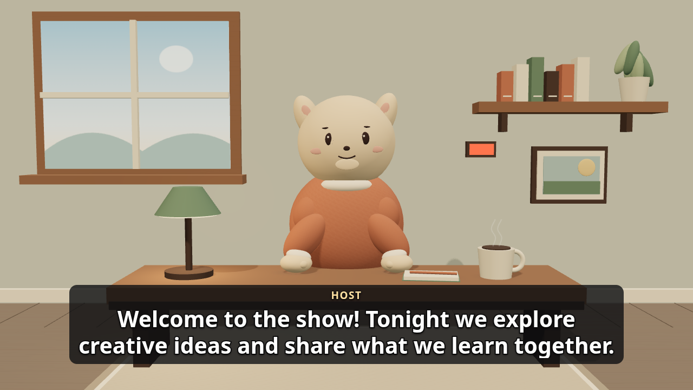

# OBS overlay

For an optional owner-built 3D room and character on a separate Browser Source, see [3D scene](scene.md).
The scene does not play sound; the overlay below remains the source of captions and voice.



Add a Browser Source in OBS using the loopback overlay URL printed by the application (the port is configured with `overlay_port`). Set the source dimensions to match the canvas, for example 1920 × 1080. The background is transparent except during privacy or while disconnected, when an opaque “Be right back” cover is shown. Keep the source visible and its audio enabled in OBS; the overlay does not change desk controls.

Optional query parameters can be combined, for example:

```
/overlay?layout=captions&theme=light&scale=1.25
```

- `layout=full` (default), `captions`, `chat`, or `alerts` selects visible surfaces. Audio still plays in every layout unless muted in the desk. Each Browser Source is a separate client: use only one audio-enabled source if combining layouts, or OBS will play voice more than once. Privacy covers each source.
- `status=1` opts into a small show-state marker in the full layout while the show is on; it says `ON` or `APPROVAL`. It does not indicate OBS or broadcast status. The marker is hidden by default.
- `theme=dark` (default) or `light` changes panel colors; the surrounding canvas stays transparent.
- `scale` is a positive number, default `1`, clamped to `0.5`–`2`. Invalid values use the default. For a 1920×1080 design use approximately `0.667` at 720p or `1.333` at 1440p.

Override CSS custom properties in OBS Custom CSS to change the font and appearance (`--font`, `--ink`, `--outline`, `--accent`, `--chat-backdrop`), sizing (`--caption-size`, `--chat-size`, `--scale`), caption placement (`--caption-bottom`, `--caption-width`, `--caption-x`), chat placement (`--chat-width`, `--chat-height`, `--chat-bottom`, `--chat-left`, `--chat-right`) or the show-state marker (`--live-top`, `--live-left`). To put chat on the left and align its message cards to the left edge, set `--chat-left: 1.5em; --chat-right: auto; --chat-align: flex-start`. Captions shrink no lower than 36 px at the default scale and are limited to two lines. Longer captions are split into two-line pages paced with voice playback or, without voice, a reading-time estimate.

Captions and chat are temporary; support alerts are displayed in arrival order. Alerts have no sound. Mute stops voice immediately but leaves captions visible; unmuting does not replay interrupted clips. Privacy clears visible content, queued alerts and audio synchronously on receipt, and nothing cleared is restored when it lifts. A connection failure likewise clears content and covers the source until a new state snapshot arrives. Reconnects use bounded exponential backoff; old events are not replayed. A source that has not received the privacy event cannot react until it does, so keep OBS's own scene controls available as a backup.

If the browser blocks autoplay, an **Enable audio** button appears. Interact with the Browser Source in OBS and click it while the clip is still current; browser autoplay policies vary. A privacy cut, mute, stop, new clip, or disconnect discards the blocked clip. Captions continue if audio is unavailable. Test audio and privacy in OBS before going live.

For a local rehearsal, run `python tools/dev_fake_show.py --guard real --voice` and use its printed overlay URL. The fake voice clips are silent; see `tools/README.md` for controls. The overlay uses the local SSE and audio endpoints only, and includes no external assets. Viewer text is displayed as text, not HTML.

For visual testing only, the Chromium test harness intercepts the stylesheet for `?bg=test` and adds a synthetic busy backdrop. This query alone has no effect in production, preserving transparency. Set `OVERLAY_R2_SHOTS` when running `tests/overlay/test_overlay_r2_browser.py` to capture the fixtures.
