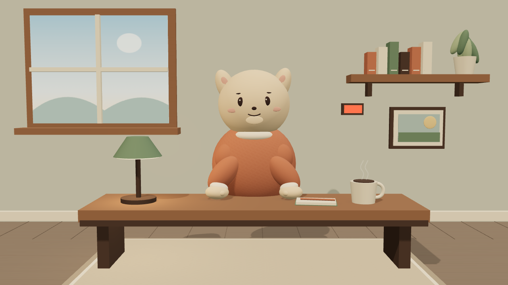
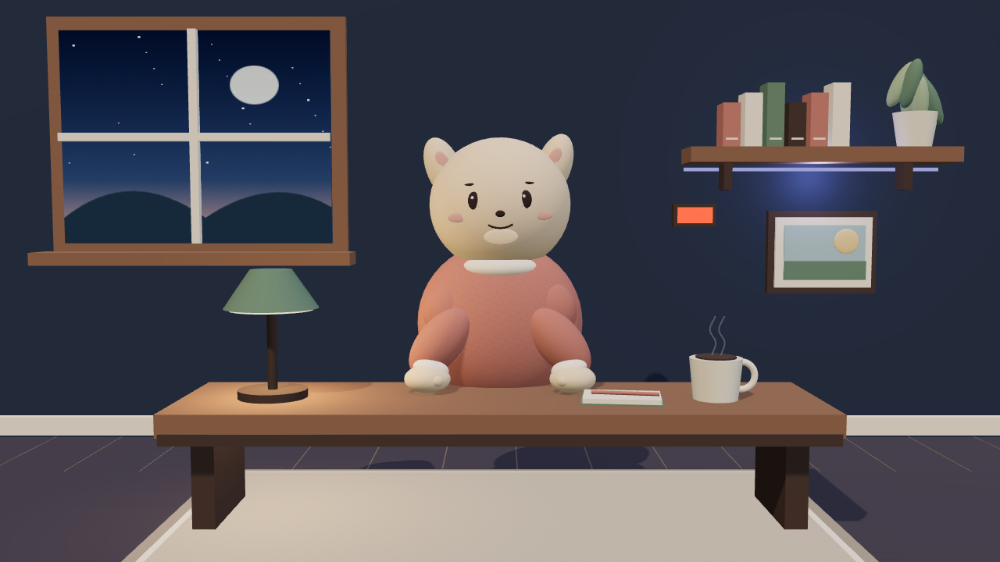
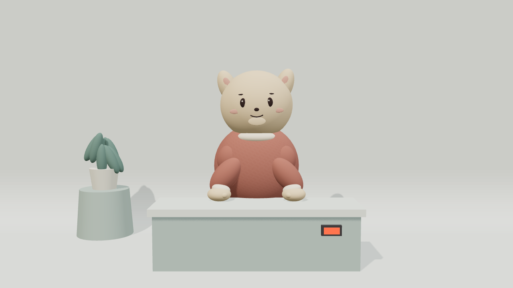

# Optional owner 3D scene

On Air's overlay has no built-in avatar and the plugin supplies no camera, guest video or host
video. An optional, **owner-controlled** three.js scene adds a code-built room and character as a
separate OBS Browser Source. It is not face tracking, avatar generation or a video-call feature.
The existing `/overlay` remains the only source of captions and voice; the scene plays no audio.



*The starter scene, rendered in a private synthetic preview; captions remain a separate source.*

## Create and preview

Choose the Hermes home that runs the intended overlay: a private show's owner home and a separate
stage home have **different** `plugin-data` directories. In that home run:

```sh
hermes onair scene
hermes onair scene preview
```

The first command creates `<HERMES_HOME>/plugin-data/on-air/scene/`, downloads pinned three.js
0.187.0 and @pixiv/three-vrm 3.5.5, verifies their SHA-256 digests and installs only required modules
and licence files under `vendor/`. It needs network access once; a failed download or digest check
leaves an existing scene untouched. `hermes onair scene --force` replaces the entire scene including
owner models and edits: back them up first and use it only with explicit consent.

The second command starts a **private synthetic preview** on a temporary loopback port and prints
its URL. It cycles off air, live, a sample caption and generated speech-like WAV, synthetic chat,
a support alert, privacy, live, and stop. It uses no provider, real chat, show or sound playback.
The silent scene fetches the WAV to animate its mouth. Open the URL, inspect a screenshot, then
Ctrl-C to stop it. This preview is not an OBS or real stage check. No browser or network is needed
for the preview server itself after scaffolding.

With the real private show or stage overlay running, open
`http://127.0.0.1:PORT/scene/` privately, substituting that overlay's configured port. The scene
exists only while that server is running and only if its own home contains `scene/index.html`.
Do not expose the loopback server or use untrusted scene code or models: scripts in a scene share
an origin with the overlay events and audio. The server serves no dotfiles, symlinks or unlisted
file types, streams large models, and allows scene scripts only from its own origin.

For an owned switchable OBS view, set `presentation.scene_view: true` in the owner plugin settings
and run `onair_obs_setup configure`; see [Views and boxes](views.md). It derives the loopback
`/scene/` URL from the configured overlay origin, creates a silent Browser Source and reuses the
one captions/voice overlay on top. Alternatively, add **one** Browser Source by hand, 1920x1080,
with the loopback scene URL; use `/scene/?bg=transparent` for the character alone as a layer.
Keep only one audio-enabled captions/voice overlay to avoid duplicate voice. Make sure OBS can
reach the same loopback host as the server. Check the OBS preview before going live; keep OBS
scene and mixer controls available for safety.

## Themes, shots and show staging

Choose `"theme": "cozy-day"` (default), `"night-studio"` or `"clean-stage"` in
`scene.json`. The first is the furnished daylight room; night adds a starry window, warm lamp and
soft violet shelf light; stage has a minimal sweep and podium. Unknown names warn in the console
and fall back to `cozy-day`. `?theme=night-studio` temporarily overrides the file. For colours,
`"palette": {"wall": "#394557", "floor": "#514c54", "accent": "#c28172"}` overrides the
chosen theme. The legacy top-level colour fields remain effective for `cozy-day` only.




Set `"shot": "wide"` (default), `"medium"` or `"close"`; `?shot=close` overrides the file, so
separate OBS Browser Sources can use different shots. Combine with `&bg=transparent`. Reserve the
lower part of the frame for captions, which are supplied by the separate overlay.

The unlettered red tally glows only for live approval/autonomous state; off air dims the main rig
over about 600 ms. Public chat can trigger a character glance at most once per four seconds;
support alerts can trigger a character reaction, soft pooled particles and a tally pulse for up to
2.5 seconds, also rate-limited. The starter character may not implement optional reactions. Muting
leaves the room unchanged and keeps the mouth neutral.

Privacy and event-stream loss immediately hide the entire canvas under an opaque neutral curtain;
transparent mode hides the canvas without drawing a colour. Before the first valid snapshot the
starter is covered. A fresh valid non-private off-air snapshot lifts the curtain and shows the
starter with a neutral mouth; a valid live non-private snapshot also lifts it. These are browser-layer
protections, not a substitute for OBS's own privacy controls: a disconnected Browser Source cannot
guarantee what OBS last captured.

## Character and room

The starter builds a matte room, desk, daylight window and mascot from local geometry and
procedural canvas textures. The mascot blinks and breathes. For a voiced caption the mouth follows
an envelope decoded from its same-origin WAV; caption-only or unrecognized audio uses the original
procedural rhythm for the caption TTL. A clip ending closes the mouth even if text remains.
Edit `scene.json`: `wall`, `floor` and `accent` are CSS colours; `camera` is the three-number camera
position; `characterScale` scales the starter; `avatarFraming` (`bust` default, `waist`, `full`,
`manual`) auto-frames a VRM, `avatarPose` (`relaxed` default or `tpose`) lowers or keeps the
T-pose, and `avatarScale`/`avatarPosition` apply in `manual` framing.
Change `"voiceOffsetMs"` (starter value 0) to nudge the voice animation: positive delays the mouth,
negative advances it, clamped to -2000 through 2000 ms. The default when absent is 0. Values affect
the next page load. The starter's wide camera looks toward `[0, 1.65, 0]`; automatic VRM framing
repositions the camera for the selected shot.

The scene estimates start as the audio-event arrival plus its measured fetch and decode time, capped
at 500 ms, then applies the offset. The overlay begins its own Audio playback as soon as it can;
caption paging tracks that playback. The two browsers have independent scheduling, buffering and
possible autoplay unlock, so the difference is not measurable from the scene and no fixed maximum
sync error is promised. Tune the offset in a private real-show OBS test, listening to the one
existing audio-enabled overlay; the synthetic preview does not verify OBS playback.

To use a VRM instead, place a trusted file named
`avatar.vrm` in the scene folder. Make one in VRoid Studio or choose a model with suitable rights,
including CC0 where applicable; check its actual licence, attribution and streaming permissions.
The scene no longer requires `aa`/`blink` expressions: a model loads and performs whatever it can
(idle motion, pose, look-at, moods, lip-sync — each only if the model supports it), and a file that
fails to load keeps the code-built mascot. Inspect `document.body.dataset.avatar` in browser
developer tools: `vrm` means the model loaded, `starter` is the mascot, `fallback-load-error`
means the file was rejected. `data-avatar-pose` reports `relaxed` or `tpose` and
`data-avatar-left-arm-y`/`-right-arm-y` read about `-0.96` when the arms were lowered.

Out of the box the VRM stands in a relaxed stance (upper arms down, slight elbow
bend, softly curled fingers when finger bones exist, slight weight shift and asymmetry). The built-in
rooms hide their desk or podium for a VRM and retain it for the seated mascot. The VRM stays
alive: breathing, sway, head drift, randomised (sometimes double) blinks, eye saccades and
look-at near the camera, spring bones for hair/tail/clothes, loudness-scaled nods and micro body
motion while speaking, `aa`-led lip-sync blended with `ih`/`ee`/`ou`/`oh` when present, and preset
mood expressions with eased blends. Bound standard mood presets take priority; if one is empty,
recognized optional custom brow and mouth channels can provide a limited fallback. Custom mouth
weights remain modest during speech and are cleared with the visemes. Models lacking matching
channels remain neutral. Captions pick a local mood from punctuation and a short word
list (question → thinking, exclamation/laugh words → happy, wow/whoa → surprised, apology → sad);
the caption text is never rendered by the scene. Idle motion continues when speech stops; mood
blends ease toward neutral. Clear/Stop/mute/privacy/disconnect zero the driven mouth expressions.

Frame the model with `scene.json`: `avatarFraming` is `bust` (default), `waist`, `full` or
`manual`. The first three auto-scale and place the model from its bounding box and reposition the
camera for each shot; check the resulting face and headroom at 480x270 for your particular model.
`manual` restores direct `avatarScale`/`avatarPosition` control with the configured `camera` and shot.
`avatarPose` is `relaxed` (default) or
`tpose` to keep the authored pose. Optional character controls exist for both the mascot and the
VRM — `setMood(name)`, `glance(xNorm, yNorm, ms)`, `react('alert'|'greet'|'nod')` and
`setPresence('live'|'offair'|'privacy')` — and owner scripts may call them defensively
(`typeof c.x === 'function'`). The scene does not generate an avatar or use a camera, face
tracking or its own voice.

The owner or agent may edit `room.js` (`buildRoom(scene, config, transparent)`) to create the
room. Its exported `themes` registry maps names to `{palette, lights, build}`: `build` receives
`(scene, config, transparent)` and returns a group; `lights` contains `ambient`, `key`, `fill` and
`rim` colours. A room may expose `group.userData.setTally(live, pulse)`, `animate(t)` and
`setPerformer(standing)`; the built-in rooms use the latter to hide furniture for a VRM. Keep all
room geometry and its decorative particles inside the group and set `group.visible = !transparent`.
`lighting.js` manages the shared rig, `character.js` the character, `events.js` the event wiring,
`geometry.js` for `mat`, `textureMaterial`, `box`, `sphere` and `cylinder` helpers, `scene.css` for page sizing,
`index.html` for the local module entry, and `scene.js` for camera/rendering. Start from a brief covering mood, colours, time of day,
three to five props and the space needed for captions and slides. Favour matte colours, a key and
ambient/fill light, soft shadows and a few large shapes. Keep the face legible at 1080p and in a
small inset. High quality caps pixel ratio at 2 and uses a 2048 shadow map. `quality` in
`scene.json` is `auto` (default), `high`, or `low`; `?quality=low` overrides it for one source.
In auto, if at least 75% of frame intervals exceed 40 ms over a two-second window, the scene
switches to low until reload. `data-quality` reports the active level. Low uses a 0.5 pixel ratio,
no shadow map, no fill/rim lights, and no alert particles (the tally still pulses). High forces the
original settings. Hidden pages reset the sampling window. A low setting can still be too slow for a
complex avatar: measure the actual scene. If OBS's Browser Source lacks GPU acceleration, try
`"quality": "low"`, a 1280x720 Browser Source scaled up in OBS, and 30 fps. Verify the visual quality,
lip sync, and performance in that OBS instance; this is not a performance guarantee. Avoid allocations in
the render loop and measure
whether the owner's OBS machine reaches 30/60 fps. Owner GLB props can be added in code; verify
licences before using any asset. Take a private screenshot, inspect it, iterate and show the owner
before using it on air. Never copy third-party rooms without the appropriate rights.

### Example frame-interval measurement

One detailed VRM (about 486,000 node-instanced triangles before visibility) was measured at commit
`08cc022` in headless Chromium on a shared machine. Each run used a two-second warm-up and about
four seconds of animation-frame intervals; GPU measurements are paced by the display. GPU was an
RTX 4060 Ti through ANGLE Vulkan at forced high quality; software was ANGLE SwiftShader at forced
low quality. These are **not OBS measurements**, and software runs yielded only 9–11 sampled
intervals, so the averages are noisy rather than sustained benchmarks.

| Theme | GPU 1920×1080 | GPU 1280×720 | Software 1920×1080 | Software 1280×720 |
|---|---:|---:|---:|---:|
| cozy-day | 16.67 ms | 16.67 ms | 431.66 ms | 448.32 ms |
| night-studio | 16.67 ms | 16.67 ms | 488.88 ms | 410.59 ms |
| clean-stage | 16.67 ms | 16.67 ms | 434.98 ms | 372.71 ms |

The software result was nowhere near 30 fps even at low quality. Use a lighter model or an
accelerated browser source if available, and verify the actual OBS configuration before a show.

## Safety check

The mouth follows a voiced clip's loudness without playing it, or uses caption-timed procedural
motion when no usable clip arrives. It closes immediately on caption clear, non-live/paused/privacy/
Stop or muted state and event disconnection. Captions received while muted do not reopen the mouth.
In a private real-show test, verify all of those, including Stop and loss of connection, and verify the
OBS composition. A disconnected Browser Source cannot guarantee what OBS last captured: use OBS
controls as a backup. The packaged owner skills `on-air:scene`, `on-air:scene-build` and
`on-air:avatar` contain the corresponding agent procedures.
